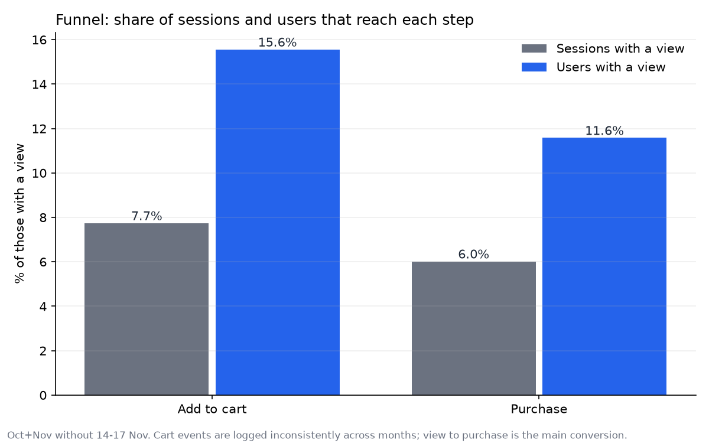
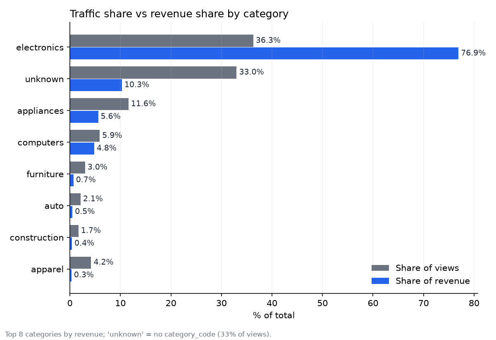
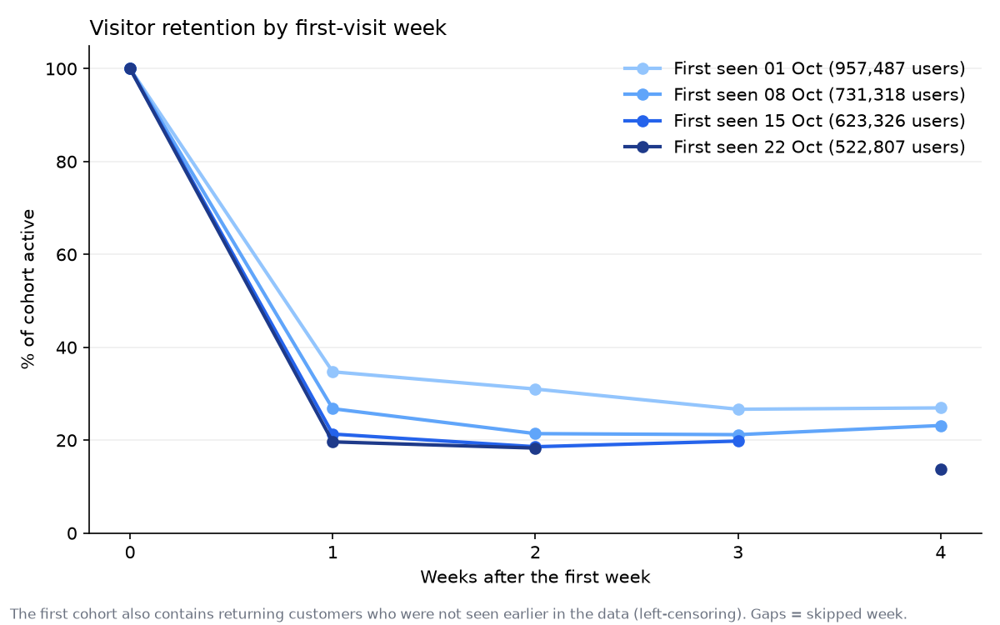
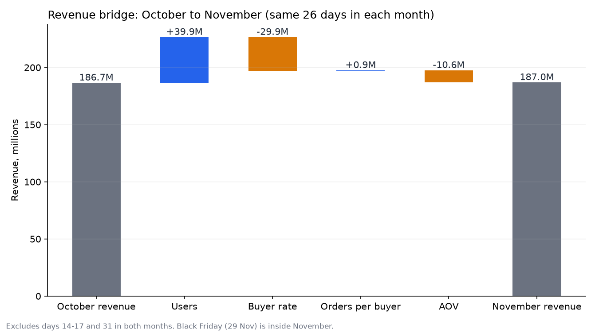

# E-commerce product analytics: funnel, revenue bridge and an A/B test for an installment feature

**Conclusion:** extra traffic in November did not become extra revenue (186,687,995 in October versus 186,978,477 in November over the same 26 days) because a smaller share of users bought and baskets were smaller; the biggest lever is expensive electronics and appliances, where showing a monthly payment is worth an A/B test.

**Start here:** the one-page memo for a product manager, [docs/readout.md](docs/readout.md).

Data: [REES46 eCommerce behavior data from a multi-category store](https://www.kaggle.com/datasets/mkechinov/ecommerce-behavior-data-from-multi-category-store) (October and November 2019, 109,950,743 events: view, cart, purchase).

## Business questions and answers

| Question | Answer | Where |
|---|---|---|
| Where does the funnel leak? | 6.02% of sessions with a view end in a purchase and 11.58% of users buy; the widest drop is at the first step; weakest categories are computers, apparel and furniture | `sql/02_funnel.sql` |
| Which categories matter? | Electronics: 36.3% of views and 76.9% of revenue; a third of views have no category | `sql/03_categories.sql` |
| Do users come back and buy again? | Between 19.65% and 34.73% of new visitors are active a week after the first week, depending on the cohort; 35.7% of buyers buy more than once in October-November | `sql/04_retention.sql` |
| Why did revenue change from October to November? | It did not: more users, but a lower buyer rate and smaller baskets (revenue bridge) | `sql/05_revenue_decomposition.sql` |
| How big is the opportunity of an installment label? | 1.32% / 3.29% / 6.58% of period revenue in three assumed scenarios | `sql/06_installment_sizing.sql`, `docs/feature_sizing.md` |
| How would we test it? | User-level A/B test, 14 days, detects a 1.60% relative change in conversion | `sql/07_ab_baseline.sql`, `docs/ab_test_design.md` |

What sets the project apart: a **revenue bridge** (users x buyer rate x orders per buyer x AOV), **feature sizing before a test** with every assumption listed (the data has no payment information, so the uplift is scenario-based), and a **complete A/B design** with a decision rule fixed in advance.

## Key numbers

| What | Number | Query |
|---|---|---|
| Events after cleaning (from 109,950,743 raw) | 109,532,442 | C3 in `01a_build_clean_events.sql` |
| Users / sessions | 5,316,010 / 22,752,678 | A17 |
| Session conversion, view to purchase | 6.02% | F1 |
| User conversion, at least one purchase | 11.58% | F2 |
| Electronics: share of views / share of revenue | 36.3% / 76.9% | C1 |
| Repeat purchase rate (October-November, 14-17 Nov excluded): buyers with 2+ orders | 35.7% (210,590 of 589,759 buyers) | R2 |
| Week-1 retention: share of a first-visit-week cohort active one week after the first week | 34.73% (cohort of 1-7 Oct) down to 19.65% (cohort of 22-28 Oct); the first cohort is higher because it also contains returning customers not seen earlier | R1 |
| Revenue, October vs November, same 26 days | 186,687,995 vs 186,978,477 | D2 |
| Buyer rate, October to November | 11.03% to 9.40% | D1 |
| AOV, October to November | 362.4 to 342.3 | D1 |
| Items priced 360+: share of views / share of revenue | 24.7% / 65.9% | I1 |
| Installment scenarios (assumed uplift +2% / +5% / +10%) | 1.32% / 3.29% / 6.58% of period revenue | I2 |
| A/B test: primary metric is the share of exposed users who buy (baseline 12.79%); smallest detectable change in 14 days | 1.60% relative, 418,458 users per arm | `src/ab_power.py` |

Amounts (revenue, AOV) are in the price units of the dataset; the source does not state the currency.

## Charts






## Project structure

| Path | Content |
|---|---|
| `sql/` | numbered DuckDB queries, one file per analysis step |
| `src/` | conversion to Parquet, SQL runner, charts, power calculation |
| `docs/analysis_plan.md` | definitions and business questions, written before any metric was computed |
| `docs/data_cleaning_rules.md` | every cleaning rule with the number of rows it affects |
| `docs/feature_sizing.md` | installment feature: segment, scenarios, assumptions |
| `docs/ab_test_design.md` | hypothesis, metrics, MDE and duration, SRM, decision rule |
| `docs/readout.md` | one-page memo for a product manager with three recommendations |
| `results/` | charts and aggregated CSV tables |
| `data/` | raw and Parquet data (not in git) |

## Tech stack and SQL techniques

DuckDB on Parquet for all metrics; Python (matplotlib, scipy) only for charts and sample-size calculations.

| Technique | Where |
|---|---|
| CTEs and conditional aggregation (`FILTER`) | all files |
| Percentiles (`quantile_cont`), `ntile`, `row_number` | `01_data_quality.sql` (A6, A10, A14), `01b_november_anomaly.sql` (B3) |
| `UNPIVOT` and `ROLLUP` | `01_data_quality.sql` (A2, A17), `02_funnel.sql` (F1) |
| Cohort windows with date arithmetic | `04_retention.sql` |
| Exact log-mean decomposition of revenue | `05_revenue_decomposition.sql` |
| Scenario table with `VALUES` | `06_installment_sizing.sql` |

## Data cleaning in short

Removed 130,739 exact duplicates, 12 rows without a session and 639 bot-like users (0.012% of revenue); treated zero prices as missing; 418,301 rows removed in total. A simple volume threshold did not separate bots from heavy shoppers, so a behavioural rule is used. Details and numbers: `docs/data_cleaning_rules.md`.

## Limitations

- **14-17 November are excluded.** Purchase events there are logged in uneven blocks (zero purchases for 37 hours, then several times the normal hourly rate) while views triple. Month comparisons use identical 26-day windows in both months. The cause is unknown.
- **Cart events are logged inconsistently across months** (53.6% of purchase sessions have no cart in October, 16.1% in November), so view to purchase is the main conversion and the cart step is diagnostic only.
- **No payment data**, so the installment uplift is assumed (+2% / +5% / +10%), not measured. No cancellations, returns or margin either.
- **Black Friday** (29 November) is inside the November window and cannot be separated from it.
- **Left-censoring:** "new" users are new to this dataset, not necessarily new to the store. The first weekly cohort includes returning customers.
- `user_id` is not necessarily one person. Bot removal is a behavioural heuristic (65 of the 639 removed users did buy something).
- Observational data: nothing here is a causal estimate.

## How to run

```bash
python -m venv .venv
.venv\Scripts\activate
pip install -r requirements.txt

# Kaggle API token required; downloads the two files (about 4.3 GB zipped), then unzip them into data/
kaggle datasets download mkechinov/ecommerce-behavior-data-from-multi-category-store -f 2019-Oct.csv -p data
kaggle datasets download mkechinov/ecommerce-behavior-data-from-multi-category-store -f 2019-Nov.csv -p data
tar -xf data/2019-Oct.csv.zip -C data
tar -xf data/2019-Nov.csv.zip -C data

python src/csv_to_parquet.py                              # CSV to Parquet, once
python src/run_sql.py sql/01a_build_clean_events.sql      # applies the cleaning rules
python src/run_sql.py sql/01_data_quality.sql A4          # run any query by its id (A1..A19)
python src/revenue_bridge.py                              # revenue bridge chart and table
python src/make_charts.py                                 # funnel, category and retention charts
python src/ab_power.py                                    # sample size and MDE for the A/B test
```

Every number in this README comes from a query in `sql/` (the query id is in the table above).

## License and data

Code: MIT (see `LICENSE`). The data is not included; see the Kaggle page for its license. Every number is reproducible from the SQL in this repository.
